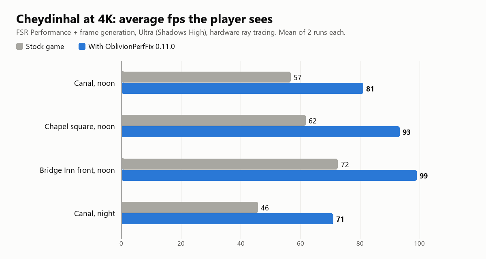

# Oblivion Remastered Performance Fix

Higher frame rates in towns and crowds, far fewer hitches while you travel, no long frame when you step out of a door,
quicker menus, and a few crash fixes, for *The Elder Scrolls IV: Oblivion Remastered*. **The game looks and plays the
same**: no lowered settings, no shorter view distance, ray-traced lighting stays on its highest setting. The fix changes
*how* the engine does its work, never *what* it draws.

**It works on any PC that runs the game**, not just ours: it has no per-PC settings or paths, it finds the code it
changes in the game itself, and its helper threads adapt to your CPU. It is not tied to AMD: players report it working
with NVIDIA and AMD graphics cards, DLSS and FSR, Intel and AMD CPUs, on Steam and Game Pass, and through OBSE64
([Compatibility](#compatibility)). How much it gains depends on your hardware: most where the CPU is the limit
([Results](#results)).

> **Built by Claude.** The profiling, the reverse engineering, the fixes, the benchmark and these docs were done by Claude,
> Anthropic's AI model, working in Claude Code. [LTSharpe](https://github.com/LTSharpe) set the goal and the rules (never
> change the look), made every decision and played every build. All of the source is here for you to read.
>
> Free and open source. If it makes your game better and you'd like to say thanks, you can
> [support the work on GitHub Sponsors](https://github.com/sponsors/LTSharpe). Entirely optional.

> **Beta.** Every build is measured in depth on our test PC (AMD Ryzen 7 5800X, AMD Radeon RX 9070 XT, Windows 11,
> Steam), and players report it working on theirs: since the first release more than 40 have reported back, on NVIDIA
> RTX 20 to 50 series, AMD Radeon RX 7000 and 9000, Ryzen and Intel Core CPUs, the Game Pass version, a handheld, VR and
> one Linux PC. Most say it runs better, a few reported problems ([Compatibility](#compatibility)). Please keep
> [telling us how it went](https://github.com/LTSharpe/OblivionRemasteredPerformanceFix/issues/new/choose), especially on
> Intel Arc, CPUs with fewer cores, Steam Deck and Windows 10.

[Results](#results) · [Install](#install-two-minutes) · [AMD ML frame generation](#optional-amd-ml-frame-generation-radeon-rx-9000) ·
[What it does](#what-it-does) · [Check it on your PC](#check-it-on-your-pc-before--after) · [Graphics settings](#find-good-graphics-settings) ·
[Uninstall](#uninstall) · [Is it safe?](#is-it-safe) · [Compatibility](#compatibility) · [FAQ](#faq) · [Help improve it](#help-improve-it)

## Results

| Measured on our test PC (yours will differ: see below) | Stock game | With the fix | Measured on |
|---|---|---|---|
| **Flight round the Imperial City** at 4K with frame generation, frame rate capped at 60 before frame generation | 72 fps, 1% low 33, 19.5 hitches of 50 ms or more per flight, worst frame 135 ms | **102 fps** (+41%), 1% low 45, **4.8 hitches**, worst frame 66 ms | 1.0.0-beta |
| **Flight through Cheydinhal** at 4K, no frame generation | 55 fps, 1% low 26, 4-6 hitches of 50 ms or more | **63 fps**, 1% low **43**, **no hitch** | 0.16.2 (before the first public release) |
| **Cheydinhal streets** at 4K with frame generation (3 views) | 64 fps (1% low 50) | **91 fps** (1% low 68), +43% | 0.11.0 |
| **Cheydinhal when the CPU is the limit** (720p, no frame generation) | 45 fps | **57 fps**, +25% | 0.11.0 |
| **Stepping out of a door** at 4K: the worst frame as the picture comes back | 187 ms | **95 ms** | 0.11.0 |
| **Opening the menu** on the Graphics page at 4K | 0.74 s freeze | **0.43 s** | 0.11.0 |
| **Opening the pause menu or the inventory** at 4K | 0.36 s freeze | **0.20 s** | 0.11.0 |
| **Alt-tab** after using the inventory or the map | FSR and frame generation stay off | back on at once | 0.11.0 |
| **Pause menu, first open after a while** (game bug, issue #5) | one bright wrong frame, every time in our test | **never** | 1.2.3-beta |

**New in 1.2.3** (the main thread's work per frame, which decides the frame rate where the CPU is the limit; 4K, FSR
Performance, frame generation, frame rate capped at 60; public scenes in `bench/scenarios/`):

| Where (scenario, scene) | Switch off | Switch on (the 1.2.3-beta default) | Fixes |
|---|---|---|---|
| Brindle Home horse corral (`playlog-spots`, `brindle-corral-hold`) | 10.6 ms | **9.2 ms**: time over 16.7 ms per frame -87% | `PhysAnimNoEmptyLock`, `RigTraceReuse` |
| Skingrad forest (`skingrad-spots`, `sk-d`) | 9.7 ms (tick work) | **8.5 ms**: time over 16.7 ms -50% | `ChaosMaxPayloadSize` |
| Vilverin, Imperial City flight (`ic-spots`, `ic-vilverin-pass`) | 8.8 ms (tick work) | **7.6 ms**: -32% | `ChaosMaxPayloadSize` |
| Imperial City Waterfront (`ic-spots`, `ic-waterfront-pass`): the one frame where an area's set-up meets waiting characters | every waiting character's clothes, hair and body steps in that frame | **a shorter frame** in our tests; the steps follow in the next frames | `PacingLeanFlowDrain` (pull request #25) |

These compare 1.2.3 with those switches off and on (everything else on), not with the stock game, measured on
pre-release builds with the same code for these switches. `PhysAnimNoEmptyLock` and `RigTraceReuse` need the
`version.dll` route (with OBSE64 they stay off); `ChaosMaxPayloadSize` and `PacingLeanFlowDrain` work on both.

**New in 1.2.4:** fewer hitches where robed characters appear in the distance (`ClothBuildDefer`, pull request #31 by
mkusm; Peryite's Shrine, `npcburst-visual`, scene `peryite-short`: the NPC work in the creation frames 181 -> 110 ms
on our PC), the world back sooner after doors (`StreamBehindLoadingScreen`, pull request #34 by Mishu117), the HDR
autosave stall taken off the main thread (his measurements: pull request #33), a start-up crash of ours fixed, five
game bugs fixed and a new section of optional tweaks (pull requests #33 to #36 by Mishu117), and less memory kept on
16 GB handhelds. Details: [CHANGELOG.md](CHANGELOG.md).

These numbers were measured on one PC, so that every row can be repeated exactly: Ryzen 7 5800X (8 cores), Radeon
RX 9070 XT (16 GB), 32 GB RAM, Windows 11, Steam build 19115871. The fix itself is the same for every PC; what it gains
on yours depends on whether your CPU or your graphics card is the limit (below). "4K" = FSR Performance, hardware ray
tracing, Ultra with Shadows High. Every number is the mean or median of 2-4 runs per side, each
in a freshly started game, stock and fix taken in turn, driven by this repository's benchmark (you can re-run every
row: see [Check it on your PC](#check-it-on-your-pc-before--after)). The last column says which version each row was
measured on: the Cheydinhal flight with a build that had about two thirds of today's fixes, the street, door and menu
rows with the first third of them. Later versions only add fixes (the later ones target travel, towns and crowds), so
we expect those rows to be unchanged or better now; we have not re-measured them on 1.2.3.

- **Your gain depends on your PC.** It is largest where the CPU holds the game back: towns, crowds, travel, high frame
  rates, frame generation (which needs a high base frame rate). **Where your graphics card is the limit** (say native 4K
  in a rainy forest) the frame-rate gain is smaller or none, **but it is still worth installing**: the hitches in towns,
  while travelling, at doors and in menus are CPU work, and those improve on any graphics card.
  [Check it on your PC](#check-it-on-your-pc-before--after) and [find good graphics settings](#find-good-graphics-settings).
- **Crowds can still dip.** The game's main thread does the same work as before, and in busy places it is the limit.
- **Some hitches remain.** Crossing into a new part of the world still costs a little, mostly the old engine's own
  loading; at normal travel speed you will rarely notice it.
- **The image is unchanged:** screenshots with the fix on and off were compared automatically at dawn, noon, dusk and
  night, in clear weather, cloud, fog, rain and thunderstorms. The differences are the same size as between two runs
  without the fix.

## Install (two minutes)

1. Download `OblivionPerfFix-<version>.zip` from [Releases](https://github.com/LTSharpe/OblivionRemasteredPerformanceFix/releases)
   or from [Nexus Mods](https://www.nexusmods.com/oblivionremastered/mods/5709) (the same files).
2. Open the game folder: in Steam, right-click *Oblivion Remastered* > *Manage* > *Browse local files*.
3. Extract the zip into that folder. It puts two files into `OblivionRemastered\Binaries\Win64\`: `version.dll` and
   `OblivionPerfFix.ini`.
4. Play. To check that it works, open `OblivionRemastered\Binaries\Win64\OblivionPerfFix.log`: it lists each fix as
   it is applied.

| You use | Do this |
|---|---|
| Steam, no mod manager | the four steps above |
| Vortex or Mod Organizer 2 | install the same zip as a mod: it has the game's folder layout. In Mod Organizer 2 the files must land in the game's folder, not in `Data` (use its Root Builder plugin, or extract by hand) |
| OBSE64, or another mod that already uses `version.dll` (some upscaler mods do) | don't overwrite that `version.dll`: download `OblivionPerfFix-<version>-OBSE.zip` instead and extract it into the game folder. It puts `OblivionPerfFix.dll` and its ini into `OblivionRemastered\Binaries\Win64\OBSE\Plugins\`, where OBSE64 loads it. Many fixes can only be put in place before the game's own code runs and stay off on this route ([which ones](#obse64-route-what-stays-off)); the log says so for each. If both are installed, the fix loads once |
| Xbox / PC Game Pass (experimental) | download `OblivionPerfFix-<version>-GamePass.zip`; its files go into `OblivionRemastered\Binaries\WinGDK\` in the game's folder (usually `C:\XboxGames\The Elder Scrolls IV - Oblivion Remastered\`). Reported working by a few players; less tested than Steam: the log says which fixes found their code, and no log at all means it didn't load. A [test report](https://github.com/LTSharpe/OblivionRemasteredPerformanceFix/issues/new/choose) helps everyone |
| Steam Deck / Linux (one Linux report so far; Steam Deck untested) | as for Steam, then add `WINEDLLOVERRIDES="version=n,b" %command%` to the game's launch options |

**Check where the files landed** (a mod manager can put them in the wrong folder):

| Zip | Files | Folder (inside the game folder) |
|---|---|---|
| `OblivionPerfFix-<version>.zip` | `version.dll`, `OblivionPerfFix.ini` | `OblivionRemastered\Binaries\Win64\`, next to `OblivionRemastered-Win64-Shipping.exe`. Not in `OBSE\Plugins`: the game never loads a `version.dll` from there |
| `OblivionPerfFix-<version>-OBSE.zip` | `OblivionPerfFix.dll`, `OblivionPerfFix.ini` | `OblivionRemastered\Binaries\Win64\OBSE\Plugins\` |
| `OblivionPerfFix-<version>-GamePass.zip` | `version.dll`, `OblivionPerfFix.ini` | `OblivionRemastered\Binaries\WinGDK\` |

The log, `OblivionPerfFix.log`, appears next to the DLL at the first start; no log means the fix was not loaded.

### OBSE64 route: what stays off

OBSE64 loads its plugins after the game's own code has started, and many fixes can only be put in place before that.
With the OBSE package these stay off (the log says so for each): `ViewRenameGuard`, `NpcFadeInNoRebuild`, `FrozenClothStretchFix`, the four `WaterCapture*` fixes, `RayTracingBuildBatch`, `RtSceneBufferKeep`, `InstanceClearReserve`, `OsPageCache`, `NavLinkFast`, `ParallelStaticBodies`, `PipelinedBodyCreation`, `DirtyTreeQuickInsert`, `BulkIndexInsert`, `PhysicsPushParallel`, `PhysicsDestroyBatch`, `PhysAnimNoEmptyLock`, `NpcBodiesOneLock`, `ClothRegisterLite`, `RigVmHashMemo`, `RigLogicMapCache`, `RigTraceReuse`, `AnimTeardownParallel`, `CellBufferPacedEvict`, `ClothBuildDefer`, `ScreenshotReadbackConvert`, `ScreenshotParallel`, `SaveBytesBulk`, `SaveRefIdIndex`, `MenuOpenFlashFix`, `ShaderScreenAfterDriverChange`, `BowSneakAttackFix`, `AutosaveFollowsMenu`, `FrameGenCameraInfo`, `FrameGenPacingTuning`, `TaskWaitDeadlockGuard` (and `PsoCompileThreadPool`, which needs it), and the diagnostics `HitchLedger` and `HitchLedgerTickSplit`; `FrameGenAsyncCompute` keeps the game's value. The others work on both routes,
among them `ChaosMaxPayloadSize`, `NpcCreationPacing`, `NaniteInitialRootPages`, `FrameRateLimitAtStart`,
`PsoPrecompileFast` and the Lumen, upload and GPU-scene memory fixes. If you can, use the `version.dll` package.

**Updates:** track the mod on [Nexus Mods](https://www.nexusmods.com/oblivionremastered/mods/5709) (Vortex and Mod Organizer 2
then show when a new version is out), or on GitHub choose *Watch > Custom > Releases*. To update, extract the new zip
over the old files. If you changed settings in `OblivionPerfFix.ini`, set them again in the new one: new fixes come with
new keys.

Nothing else to set up: the defaults are what we recommend, and the fixes adapt to your PC (see
[Compatibility](#compatibility)). Every fix has its own switch in `OblivionPerfFix.ini` (1 = on, 0 = off), explained in
the file itself, which has three parts:
1. **Performance improvements** (all on): the game's own work done in a cheaper way.
2. **Game bug fixes** (on, except two that say why they are off): the game does what it was meant to. Set them to 0 to
   stay closer to the stock game; leave the crash and freeze guards on.
3. **Optional tweaks** (all off): they may change the look or how the game plays; switch one on only if you want it.

## Optional: AMD ML frame generation (Radeon RX 9000)

The game ships AMD's FSR 3.1.0, whose frame generation is the older, analytical kind. On a **Radeon RX 9000** graphics
card, AMD's driver can run **AMD's ML (machine-learning) frame generation** instead, and since Adrenalin 26.10.1 also
its own, newer frame pacing ("in supported titles with AMD FSR Frame Generation 3.1.6/4.0.0 or newer", AMD,
[21 Oct 2026](https://www.amdgaming.com/blog-news/89d77bfe-fda6-40b1-93c6-918dc14ee93b)). Both need a newer FSR than the
game's. You can give the game AMD's current signed files, from the **FSR SDK v2.3.0** (the newest release, June 2026):

1. **Update AMD Software: Adrenalin Edition** to 26.10.1 or newer (ML frame generation arrived with 25.12.1; on our PC
   the driver started running frame generation's pacing itself with 26.10.1).
2. **Download three files** from AMD's [FSR SDK v2.3.0](https://github.com/GPUOpen-LibrariesAndSDKs/FidelityFX-SDK/releases/tag/v2.3.0)
   on GitHub (on each page, click *Download raw file*):

   | File | Size, version | SHA-256 |
   |---|---|---|
   | [`amd_fidelityfx_loader_dx12.dll`](https://github.com/GPUOpen-LibrariesAndSDKs/FidelityFX-SDK/blob/v2.3.0/Kits/FidelityFX/signedbin/amd_fidelityfx_loader_dx12.dll) | 26,376 bytes, 2.3.0.2740 | `E2D85AA05A9BD9ED8B38935FDF5199372CCA6F74C12015143BB6F945EE1608AA` |
   | [`amd_fidelityfx_framegeneration_dx12.dll`](https://github.com/GPUOpen-LibrariesAndSDKs/FidelityFX-SDK/blob/v2.3.0/Kits/FidelityFX/signedbin/amd_fidelityfx_framegeneration_dx12.dll) | 40,085,776 bytes, 4.0.1.2740 | `02297BEEDD285E822D3A64F314CF00FAF378DCEC0EDC47FF0C4DD71B3A8C2F18` |
   | [`amd_fidelityfx_upscaler_dx12.dll`](https://github.com/GPUOpen-LibrariesAndSDKs/FidelityFX-SDK/blob/v2.3.0/Kits/FidelityFX/signedbin/amd_fidelityfx_upscaler_dx12.dll) | 28,761,864 bytes, 4.1.1.2740 | `D0DCCCC74A43C44BA435B7A369B456E0970D8A4464E4BD683119B374F2C9FB46` |

   Each is digitally signed by Advanced Micro Devices (right-click > *Properties* > *Digital Signatures*).
3. **Back up the game's own file:** in the game folder, go to `OblivionRemastered\Binaries\Win64\` and rename
   `amd_fidelityfx_dx12.dll` to `amd_fidelityfx_dx12.dll.original`.
4. **Put the files there:** `amd_fidelityfx_loader_dx12.dll` **renamed to `amd_fidelityfx_dx12.dll`** (the game loads
   that name; AMD documents the loader as interface- and behaviour-compatible with the old file), and the other two
   under their own names.
5. **In AMD Software (Adrenalin)**, *Gaming > Graphics*: turn on *AMD FSR Upscaling* and *AMD FSR Frame Generation*
   (AMD's steps say to do this with the game closed). Leave *AMD Fluid Motion Frames* off for this game: it is the
   driver's own frame generation, and AMD uses the in-game one *instead of* it where a game has one (we have not tried
   the two together).
6. **In the game**, choose FSR as the upscaler and switch frame generation on.

**To check it**, look in `OblivionPerfFix.log` after a few minutes of play (the lines below are from our PC):
- `[fgpace] amd_fidelityfx_dx12.dll is AMD's SDK 2.x loader (file version 2.3.0.2740)`: the new files are in place.
- `[fgpace] frame generation context created: provider 4.0.2 * ...`: a provider 4.x is ML frame generation (3.x is the
  analytical kind, which you get on cards without ML frame generation).
- `[fgpace] frame generation swap chain context created: provider 4.0.0 * ... (Adrenalin's driver provider)`: the
  driver runs the pacing, and the fix leaves it alone. *(inside AMD's DLL)* there means the driver did not take over
  (an older driver, or the Adrenalin switch off): ML frame generation then still runs from AMD's file.
- `[fgcam] camera info linked N times ... AMD's library got N prepare calls, N with camera info`: ML frame generation
  gets the camera every frame.

Adrenalin's own status line is not a reliable check with these files: on an older driver it said *Upgrade Inactive*,
because the ML frame generation was already in AMD's file.

- **What the fix adds:** ML frame generation needs the camera's position and direction each frame, which the game's FSR
  3.1.0 code never sends; the fix sends it (`FrameGenCameraInfo`; without it ML frame generation runs with the camera
  at zero). On the driver's swap chain it keeps the driver's pacing (`FrameGenPacingTuning`, since 1.2.2: in our tests
  the driver's own pacing showed frames more evenly, about 30 % less frame-to-frame timing error on the Imperial City
  flight than AMD's recommended setting); on AMD's file's own swap chain it uses AMD's recommended setting.
  `FrameGenPacingTuning=3` uses it everywhere, as 1.2.1 did; only when frames are shown changes. The frame generation
  crash guard (`FrameGenCrashGuard`) is for the game's 3.1.0 and AMD's older 3.1.4 file; AMD's SDK 2.x files no longer
  have that crash, so the log says the guard is not installed there. That is expected.
- **AMD's older 3.1.4 file** (one `amd_fidelityfx_dx12.dll` from SDK v1.1.4, our earlier advice) also gets ML frame
  generation from the driver, but AMD names 3.1.6/4.0.0 or newer for the new pacing, and we have not checked what
  26.10.1 does with 3.1.4. If you used it, replace it with the three files above.
- **Undo:** delete the two extra files and rename `amd_fidelityfx_dx12.dll.original` back. Steam's *Verify integrity of
  game files* also restores the game's file (the two extra files are then unused; delete them), and so does a game
  update: do step 4 again afterwards.
- **Other graphics cards:** ML frame generation is for the RX 9000 only (AMD). With an NVIDIA, Intel or older AMD card
  these files fall back to FSR 3.1.6 frame generation and 3.1.5 upscaling (FSR 4.1 upscaling on an RX 7000), which may
  look a little different from the game's 3.1.0 and which we have not checked: there is no reason to swap them there.
  Game Pass: not tested.
- AMD's 26.10.1 notes list a known issue on the RX 9000: a crash or hang when switching apps or opening overlays with
  in-game FSR frame generation on
  ([release notes](https://www.amd.com/en/resources/support-articles/release-notes/RN-RAD-WIN-26-10-1.html)). AMD's
  workaround, V-Sync on in the game, is not available here: the game greys V-Sync out while frame generation is on.
- We have not measured a frame-rate difference against the game's own frame generation: ML frame generation is about
  the quality of the generated frames, and AMD has not said how its new pacing works. These are AMD's files and AMD's
  driver features: if anything looks wrong, undo it and tell us.

## What it does

Oblivion Remastered runs two engines at once: the original 2006 engine runs the game world, and Unreal Engine 5 draws it.
Several steps of that pipeline run on **a single CPU thread**, and when one of them is full, the whole game waits. That's
why Cheydinhal can run at 30-40 fps while Task Manager shows the CPU only about 30% busy, and why the game hitches each
time a new part of the world streams in.

The fix is one small DLL that loads with the game. For each of its fixes (about fifty) it finds the specific place in
the game's code, checks that it is exactly what it expects, and changes how that code works, in memory only. Each change does **the same work in a
cheaper way**. Two of them change only *when* something happens: far-away characters you can't see are built a few
frames later, and the cells behind you are unloaded a few frames later, both in the game's own order. Two more can at
most settle an exact tie or a split-second race differently, in ways the game itself already varies (a horse's repeated
ground check, the order in which collision checks look at nearby shapes). Those are the performance improvements (part 1
of the ini). The game bug fixes (part 2) change what the game does, back to what it was meant to do, and the optional
tweaks (part 3, all off) change the look or the play on purpose, only if you switch them on.

| Area | What was slow or broken | What the fix does |
|---|---|---|
| **Rendering** | One thread turned each frame's drawing work into DirectX 12 commands while the other cores idled; character skeletons were copied to the graphics card with an instruction that is very slow for that memory; the weather system rebuilt the sun, sky and fog every frame; cloth copied its setup every frame | translate on all cores (as Unreal Engine 5.5 does), copy the same bytes the fast way, rebuild only what changed, skip identical copies. **+22-25% fps where the CPU is the limit** |
| **Travel: memory** | While you travel, the game handed memory back and asked for it again seconds later, for lighting lists, texture uploads, the graphics card's object list, grass and its own small blocks: 20-100 ms each time | keep the memory it will need again (bounded, and handed back when Windows runs short) |
| **Travel: physics** | When a new area arrived, the physics engine rebuilt its search tree and took in thousands of trees and rocks on one thread while the frame waited | spread rebuilds over frames, build bodies on helper threads, file new entries in batches; collisions find exactly the same things |
| **Travel: characters** | A group of characters far away was created all at once (50-100 ms); crossing into a new row of cells unloaded the old ones and their characters' animation data in one frame | build far, unseen characters a piece per frame; take animation data apart on helper threads; unload the cells behind you one per frame |
| **Threads** | A thread waiting for something could pick up a whole navigation-map tile build while the frame waited for it (up to 2.5 s seen) | leave those builds to free threads (the engine's own flag, and a gap in it closed) |
| **Doors and start-up** | The first frame after a door or fast travel took in all the new area's physics at once; the start-up shader build held loading screens up to 5 s longer for the first minutes | do the physics part behind the loading screen without simulating anything; build shaders at full pace while you are not playing |
| **Menus** | Opening a menu filtered and copied a full-screen picture one pixel at a time; the Graphics page asked Windows for every display mode eight times over | the same picture computed many times faster; the mode list kept and re-checked |
| **Frame generation** | AMD's frame generation work waited in line behind the game's own frames: -20-25% rendered fps with it on | run it on the graphics card's second queue (an AMD plugin setting the game leaves off): **+22-29% rendered fps with frame generation** |
| **Horses and collision checks** (1.2.3) | Near horses, the game's main thread waited for an exclusive physics lock that animation parts with nothing to move took every frame, and the horses repeated the same ground check about 12 times a frame; every collision check in the game first went through a list of about 730 huge shapes from all over the map | skip the empty update, answer a repeated check with its first answer, file the huge shapes in the search tree like everything else: **about 1.2-1.4 ms less main-thread work per frame** at those places |
| **Characters with robes** (1.2.4) | A far-away character you cannot see built its robe's cloth simulation in the middle of its creation, often two or three times | build it once, a few frames later (at once when it comes near or into view; pull request #31 by mkusm) |
| **Doors** (1.2.4) | After a door or a fast travel the game held the last loading-screen image until the new area's textures were streamed back in | stream them while the loading screen is still idling (pull request #34 by Mishu117) |
| **Handhelds, integrated graphics** (1.2.4) | there the graphics use the PC's RAM, so the memory our fixes keep to avoid stutter can be missing for the game and Windows on 16 GB devices | on such a PC with Windows and under 20 GB of RAM, those fixes act as the game (`SharedMemoryGpu`; the 24 GB Ally X, Proton, CrossOver and Mac players are unaffected) |
| **Crashes and bugs** (part 2 of the ini) | crashes in the game's name table, its trap code, Unreal's video-memory tidying (UE-217692) and AMD's frame generation library; FSR left off after an alt-tab; a bright flash when the menu opens; since 1.2.4 (pull requests #33 and #35 by Mishu117): no shader screen after a driver update, "Show VRAM" stuck at 0/0, the wrong native resolution of very wide monitors, bow sneak attacks at 1x, magenta specks on skin above 4K | each guarded so the game carries on as it would have; FSR comes back by itself; the menu opens onto its normal background; the game does what it was meant to. Switch any of them off to stay closer to the stock game |
| **Optional tweaks** (part 3 of the ini, all off) | trade-offs some players want: the world unfrozen behind the loading screen, streamed textures kept or uploaded faster, HDR gamma 2.2, HDR menu backgrounds and save thumbnails, HDR and HUD rows in the Graphics menu, DLSS Ray Reconstruction (pull requests #34 and #36 by Mishu117) | nothing unless you switch it on: they may change the look or how the game plays |

Every fix, its switch and its numbers, in plain words: [docs/how-it-works.md](docs/how-it-works.md). The measurements
and the ideas we tested and rejected: [docs/research.md](docs/research.md).

## Check it on your PC (before / after)

Don't take our word for it: the benchmark kit plays the Imperial City flight with and without the fix, by itself, at
your own settings, on screen and with your sound, so you can see and feel the difference, and writes a report. Every
run starts from a new game, so your saves and characters are never touched. No programming tools needed.

**Get it:** download `OblivionPerfFix-<version>-Benchmark.zip` from
[Releases](https://github.com/LTSharpe/OblivionRemasteredPerformanceFix/releases) and extract it anywhere (your Desktop
is fine). Start the game once by hand first if you never have. Then double-click **`Benchmark.cmd`** (if Windows asks
whether to run a downloaded file, choose *Run*). Its window says at each step what it is doing, with the same numbers
as below. About 20 minutes in all (times from a Ryzen 7 5800X / RX 9070 XT at 4K):

1. **Benchmark tools** (first time only, under a minute): it downloads two free measuring tools from their own GitHub
   projects into the kit's `third_party\` folder: [PresentMon](https://github.com/GameTechDev/PresentMon) (Intel; frame
   times; 0.9 MB, SHA-256 checked) and the official [UE4SS](https://github.com/UE4SS-RE/RE-UE4SS) experimental build
   1181 or newer (runs the benchmark's small in-game script; 8.3 MB; its SHA-256 is checked against GitHub's and written
   into the report). UE4SS is put into the game folder only while a benchmark game runs, and taken out again after.
2. **The fix:** it checks that this version of the fix is installed. If another version or none is, it says so and
   **asks before installing**; the files it replaces are backed up in the kit's `backup\<time>\` folder, and your
   `OblivionPerfFix.ini` settings are kept.
3. **The flights:** the game opens by itself four times, in turn **without the fix** (stock), **with the fix**, without,
   with. Each time:
   - the game opens on screen, in your own window mode and resolution, with your sound;
   - it **waits at the main menu while it prepares its shaders**: the game looks idle, this is normal (about 2 minutes
     without the fix, under half a minute with it, since the fix speeds this up too);
   - it starts a new game and flies over the Imperial City (about 2 minutes), then closes.
   So about 5 minutes per stock run and 4 per fix run.
   **While it runs, don't touch the mouse or keyboard and don't switch windows.** A game that is not in front turns
   frame generation off and gets less time from Windows, so the report marks such a run "not comparable". (Mouse look
   and movement keys are ignored during the flights, but Esc or Tab still open the game's menus.) To stop early, press
   Ctrl+C or close the kit's window: the game then closes by itself (within about a minute), your settings are put
   back and UE4SS is taken out of the game folder.
4. **The report** opens at the end (`captures\bench\_report\<time>\report.md` in the kit's folder): average fps, 1% low,
   worst frame and hitches during the flight, stock vs fix, plus your settings and frame cap. It has no user name, PC
   name or folder paths in it, so you can share it in a
   [Benchmark result](https://github.com/LTSharpe/OblivionRemasteredPerformanceFix/issues/new/choose) issue (paste
   `report.md`, attach the `result-*.json` files from the same folder).

**Nothing permanent changes:** after every run your game settings are put back as they were and UE4SS is taken out of
the game folder; your saves are never used. The only lasting change is the fix itself if you let it install (step 2).
To undo that, copy the files from the kit's `backup\<time>\` folder back into the game's
`OblivionRemastered\Binaries\Win64\` folder (or uninstall the fix as [below](#uninstall)). To remove the kit, delete its
folder.

**Want to use the PC meanwhile?** Double-click **`Benchmark-Hidden.cmd`** instead: the same runs, hidden and muted.

**Game not in a Steam library** (a copy elsewhere)? Since 1.2.3 the benchmark starts it directly: set the environment
variable `OBLIVION_GAME_DIR` to the game's folder (the one with `OblivionRemastered\` in it) before you start the kit
(pull request #19 by cgisquet). A Steam install keeps its Steam launch.

"Stock" means the DLL is loaded with every fix switched off, so the game's own code runs, except the fix for the
game's frame-cap bug (`FrameRateLimitAtStart`: with frame generation on, the game forgets the frame-rate limit you saved
until you open the Graphics page; applied with FSR frame generation on AMD and Intel cards), so both sides run at the same frame-rate cap. Differences under about 5% are noise; `Benchmark.cmd -Rounds 3` (from a command prompt in the kit's folder) gives steadier numbers, `Benchmark.cmd -Rounds 1` is a quick look (about 8 minutes).

Also in the kit: **`Check-GPU.cmd`**: is your graphics card or your CPU the limit? See [below](#find-good-graphics-settings).

To repeat our table exactly, or to run the town, door and travel scenes, use the full benchmark in this repository:
[docs/benchmark.md](docs/benchmark.md#reproduce-the-numbers-in-the-readme).

### Find good graphics settings

Where the graphics card is the limit, the fix can't raise the frame rate much, but your settings can. A good place to
judge them is **the small pond by Fort Doublecross, north-east of Leyawiin, in the rain**: willows, grass, water and
rain, and little for the CPU to do, so it shows what your graphics card can carry.

- **Measured:** double-click `Check-GPU.cmd` in the benchmark kit. It plays 30 seconds at that pond in the rain at
  your settings (on screen, about 3-4 minutes with the game start; `Check-GPU.cmd -Hidden` from a command prompt keeps it
  hidden and muted) and prints the frame rate, how busy the
  graphics card and the game's main thread are, and a verdict: "your graphics card is the limit here" (with what to
  lower) or "your CPU is the limit here". Change settings in the game as usual, quit, and run it again. The check
  changes no settings itself.
- **By hand:** go there in your own game when it rains and watch the frame rate while you change settings.
- **What to lower first:** the upscaler's quality mode (Quality -> Balanced -> Performance renders fewer pixels: usually
  the biggest saving), then hardware ray tracing, then Global Illumination and Reflections. On
  the test PC at 4K, Foliage and View Distance cost the graphics card little.
- **Why:** frame generation needs a good base frame rate (aim for about 50-60 rendered fps there before you switch it
  on), and towns are where the CPU is the limit instead: settings that only cost the graphics card won't help there,
  the fix does.

## Uninstall

Delete `version.dll`, `OblivionPerfFix.ini`, the `OblivionPerfFix*.log` files and `OblivionPerfFix-gpu.txt` from
`OblivionRemastered\Binaries\Win64\` (Game Pass: `Binaries\WinGDK\`; OBSE route: your file in `OBSE\Plugins\`).
That's all: the fix changes nothing on disk, and your saves don't depend on it.

## Is it safe?

- **What it does:** every change happens in memory while the game runs; the game's files are never modified.
- **What it doesn't do:** no internet access, no registry, and it writes no files other than its own log next to itself
  (this session's and the last two, at most 8 MB each; plus a stutter report if you switch that diagnostic on), and
  `OblivionPerfFix-gpu.txt`, one line naming your graphics card and driver version (`ShaderScreenAfterDriverChange`). The DLL
  links only to Windows' `kernel32.dll`, and the only other DLL it loads is Windows' own `version.dll`, the one it
  stands in for.
- **Game updates:** if a piece of code isn't exactly what a fix expects, that fix switches itself off and says so in
  the log. The game then runs as if that fix weren't there.
- **Your saves and achievements:** saves are never touched. The fix uses no console commands and changes no game
  data.
- **Check the download:** release files are built by GitHub Actions from the source in this repository, not on anyone's
  PC. Each release lists its SHA-256 checksums and carries a build attestation you can verify:
  `gh attestation verify OblivionPerfFix-<version>.zip --repo LTSharpe/OblivionRemasteredPerformanceFix`.
- **Antivirus warnings:** a DLL named `version.dll` that loads into a game is a common technique for mods, and also for
  malware, so some scanners flag it on reflex. Each release links its VirusTotal scan (the benchmark kit's too: it holds a
  small DLL that keeps the benchmark's game window hidden), and all of the source is here to
  read (heavily commented C++, one file per fix, grouped by area).

## Compatibility

The maintainer tests every build on one PC (Ryzen 7 5800X, Radeon RX 9070 XT, Windows 11, Steam). The rest of this
table is what players reported after the first releases (GitHub issues, Nexus Mods and video comments, October 2026),
with the count where we have one. Thin rows say **please report**: a
[test report](https://github.com/LTSharpe/OblivionRemasteredPerformanceFix/issues/new/choose) helps everyone.

| | Status |
|---|---|
| Steam version, game build 19115871 | tested; works for most of the 40+ players who reported |
| NVIDIA GeForce RTX 20, 30, 40 and 50 series (driver 617.x), DLSS and DLSS frame generation | works: about 25 reports, from RTX 2070 Super to RTX 5090. Higher frame rates where the CPU is the limit, far fewer hitches in the Imperial City flight (for example 24 -> 2 hitches per flight on an RTX 4080, [#14](https://github.com/LTSharpe/OblivionRemasteredPerformanceFix/issues/14)). Problem reports on two cards with 6-8 GB, causes not found yet: hitches on a PC short of RAM ([#16](https://github.com/LTSharpe/OblivionRemasteredPerformanceFix/issues/16)), a GPU hang with DLSS ([#17](https://github.com/LTSharpe/OblivionRemasteredPerformanceFix/issues/17)) |
| AMD Radeon RX 7000 and 9000 series | works: a handful of reports (RX 7800 XT, 7900 XT, 9060 XT, 9070, 9070 XT), for example 95 -> 104 fps and 11 -> 3 hitches in the flight on an RX 7900 XT ([#10](https://github.com/LTSharpe/OblivionRemasteredPerformanceFix/issues/10)). Older Radeon cards: **please report** |
| Intel Arc graphics, XeSS | works: a community report on an Arc B580 with XeSS ([#24](https://github.com/LTSharpe/OblivionRemasteredPerformanceFix/issues/24), thanks to nyannoying1337). More Arc reports welcome |
| CPUs | reported working on AMD Ryzen 3000, 5000, 7000 and 9000 (X3D models included) and Intel Core 9th, 13th and 14th generation; all of them with 12 or more logical processors |
| CPUs with fewer threads | should work. Helper threads scale with the cores Windows gives the game. Below 8 logical processors (for example 4 cores without SMT, or 6 cores / 6 threads) the fixes that lean most on helper threads stay off and the log says so: we could only test with 16 (and with the game limited to 6 of them, where they were not slower than with them off). To try them anyway, add `ParallelMinProcessors=6` under `[Fixes]` in `OblivionPerfFix.ini`. **Please report** |
| CPUs with AVX-512, older CPUs without AVX2 | the game uses separate code paths there, each covered by the self-test (the AVX-512 one byte for byte under Intel's CPU emulator). Ryzen 7000 and 9000 (AVX-512) are reported working; Intel CPUs with AVX-512 and CPUs without AVX2: **please report** |
| Graphics cards with 8 GB or less | the parallel translation that costs video memory switches itself off on cards under 9.5 GB (the game itself is over its video-memory budget there at 1080p/1440p High). See the two problem reports in the NVIDIA row |
| Frame generation | FSR frame generation and DLSS frame generation (2x to 4x) reported fine. `FrameGenAsyncCompute` was measured on an AMD card only: if FSR frame generation looks or paces worse on another card, set it to 0 and tell us |
| Xbox / PC Game Pass version | works in three reports (for example [#4](https://github.com/LTSharpe/OblivionRemasteredPerformanceFix/issues/4), and [#13](https://github.com/LTSharpe/OblivionRemasteredPerformanceFix/issues/13): 92 -> 112 fps on an RTX 5080); one crash report without a log. Still less tested than Steam |
| Handhelds | ROG Xbox Ally X: works (a few reports, stutter much reduced). ROG Ally (16 GB): one report of whole-device freezes with 1.2.1 (cause not proven). Since 1.2.4, on Windows handhelds and PCs whose graphics use the PC's RAM (integrated graphics, APUs) with under 20 GB of RAM (16 GB devices such as the ROG Ally, Legion Go or MSI Claw), the memory-keeping fixes act as the game by themselves (`SharedMemoryGpu=2`; the log says what it found). The 24 GB Ally X keeps every fix; `SharedMemoryGpu=1` gives it the shared-memory mode too (try it if it freezes), `0` keeps every fix on a 16 GB device. Legion Go: one report of stutter at start-up. Steam Deck: untested, **please report** |
| Linux (Proton), Mac (CrossOver) | one report: works on CachyOS with the Windows files. Mac: no report. `SharedMemoryGpu` leaves Proton, CrossOver and Wine alone (Linux and macOS handle low memory their own way) |
| Windows 10 | should work (nothing in the fix needs Windows 11); no report yet |
| VR (UEVR) | works ([#12](https://github.com/LTSharpe/OblivionRemasteredPerformanceFix/issues/12)), with the `version.dll` and the OBSE64 route |
| UE4SS, OBSE64 | compatible; the OBSE64 route works in several reports |
| Large mod lists, other performance mods | large Mod Organizer 2 lists reported fine; SCSKiller reported to combine well; Engine.ini tweak packs: unclear (two reports of problems with one installed, causes not found) |
| Other mods that install a `version.dll` | conflict: use the OBSE64 route above |

## FAQ

**Does it change graphics or gameplay?** No. Every fix does the same work in a cheaper way, and screenshots with the fix
on and off match within the noise between two identical runs. Physics and AI do the same work. The only timing changes:
far-away characters you can't see are built a few frames later, and the cells you left behind are unloaded a few frames
later (about a tenth of a second). Since 1.2.3 two fixes can at most settle an exact tie or a split-second race
differently, as the game itself already does from one moment to the next: a horse's repeated ground check gets the
answer of the identical check made microseconds earlier (`RigTraceReuse`; never different in 2.6 million checked
repeats), and collision checks look at nearby shapes in another order (`ChaosMaxPayloadSize`; they find the same ones).
Each has its switch.

**Which version do I have?** Right-click `version.dll` (or `OBSE\Plugins\OblivionPerfFix.dll`) > *Properties* >
*Details*: since 1.2.3 it shows the product name and version (issue #27). The first line of `OblivionPerfFix.log` says
it too.

**Does it only work on the maintainer's PC, or on my hardware?** It works on any PC that runs the game. Nothing in it is
set up for one PC: it finds its code in the game itself, has no paths or per-PC settings, and sizes its helper threads
to your CPU. Players report it working on NVIDIA RTX 20 to 50 series and AMD Radeon RX 7000 and 9000 cards, on Intel
and AMD CPUs, with DLSS and FSR, on Steam and Game Pass and through OBSE64 (the list, and what is less tested, is under
[Compatibility](#compatibility)). Only the README's numbers come from one PC; your gain depends on your hardware
([Check it on your PC](#check-it-on-your-pc-before--after)).

**Will it break when the game updates?** It shouldn't break the game: anything it can't find exactly, it leaves alone and
logs. A fix that switched itself off needs a new release to come back.

**I don't see a difference.** Then your graphics card is probably the limit where you are: the frame rate then
depends on your graphics settings, and the fix can add little to it. The fix helps most where the CPU is the limit:
towns, crowds, travel, lower resolutions, upscaling, high frame rates, frame generation. Keep it installed anyway: the
hitches in towns, while travelling, at doors and in menus are CPU work and improve on any graphics card.
`Check-GPU.cmd` in the [benchmark kit](#check-it-on-your-pc-before--after) tells you which one is the limit.

**Which graphics settings should I use?** Your choice: the fix changes none. To find settings your graphics card can
carry, test them at the pond by Fort Doublecross in the rain, by hand or with `Check-GPU.cmd`; what to lower first is in
[Find good graphics settings](#find-good-graphics-settings).

**Does it use more video memory?** A little: about 0.5-1 GB more than the stock game, almost all of it for translating
on all cores (`RdgParallelTranslate`), which is why that one is off on 8 GB cards. `CommandAllocatorTrim` gives back
about 0.4 GB that the game (stock too) keeps after every load, once memory gets tight. If you play on an 8 GB card at
low settings and the `[mem]` line in the log shows plenty of room, you can try `RdgParallelTranslate=1`. Being over the
budget does not crash the game: Windows moves the extra video memory to system RAM, which costs speed.
Two smaller ones: `NaniteInitialRootPages` reserves about 32 MB more for Nanite's root pages from the start (the stock
game grows that buffer during play and can stall for a moment while it does), and `RtSceneBufferKeep` keeps the ray-tracing
scene buffer at the largest size the session needed instead of shrinking and regrowing it.

**My frame-rate limit is not in effect after a start with frame generation on.** A game bug: with frame generation on,
the game applies the Frame Rate Limit you saved only once you open *Settings > Graphics*. With FSR frame generation on
AMD and Intel graphics cards the fix applies it from the start (`FrameRateLimitAtStart`). With NVIDIA DLSS frame
generation, and on NVIDIA cards (where the game can turn Reflex on), it leaves the limit to the game since 1.2.2, as
without the mod: in 1.2.0-1.2.1 it applied it there too, and then NVIDIA Reflex's own limiter could
hold the frame rate far below the limit (our bug, fixed in 1.2.2). If you play with DLSS frame generation on 1.2.0 or
1.2.1, set `FrameRateLimitAtStart=0`.

**The first minute feels slower than later.** For a while after every start the game compiles graphics pipelines in the
background. The fix runs that at full speed while you are in the main menu and loading screens; if you start playing
straight away, the rest of it runs at the game's slower pace during your first minutes.

**Can I see what it did?** Yes: `OblivionPerfFix.log` lists every fix, and every 60 seconds how much work it saved.
To write no log, set `LogFile=0` under `[General]` in the ini (needs a restart; if the game then crashes with a
GPU error, the log is still created, holding only that crash report; logs from earlier sessions are left alone).

**Can I switch a fix off?** Yes, each one has its switch in `OblivionPerfFix.ini` (1 = on, 0 = off). Most can be switched
while the game runs; the file says which.

**My Documents folder is on OneDrive. Which game folder is the real one?** The game keeps its settings and saves in
`C:\Users\<you>\Documents\My Games\Oblivion Remastered\`, even when Windows has moved *Documents* to OneDrive. The copy
in `OneDrive\Documents\My Games\...` is Steam Cloud's copy of your saves; the game doesn't read it. (The fix itself
keeps nothing there: its ini and log are next to `version.dll`.)

**Can I adapt it to my setup, or to a new game patch, with an AI coding agent?** Yes, that's what
[AGENTS.md](AGENTS.md) is for: point Claude Code, Codex or Cursor at this repository and it gets the layout, the build
and test commands and the rules in a few thousand tokens. [docs/porting.md](docs/porting.md) is the step-by-step for a
game update.

## Help improve it

- **Found a problem?** [Open a bug report](https://github.com/LTSharpe/OblivionRemasteredPerformanceFix/issues/new/choose)
  and attach `OblivionPerfFix.log`. For stutter, switch on `HitchLedger=1` first and attach `OblivionPerfFix-ledger.csv`
  too: it says where each slow frame's time went.
- **Want to find out what makes a place slow?** Set `HitchLedger=1` and `HitchLedgerTickSplit=1` in
  `OblivionPerfFix.ini` before starting the game (since 1.2.3; both off by default). The game's main-thread updates are
  then timed by what they update, every 2 seconds, into `OblivionPerfFix-ticksplit.csv` (about 0.3 MB a minute);
  `python tools\tick_split.py OblivionPerfFix-ticksplit.csv` ranks them (the script is in this GitHub repository, not in
  the mod's zips). It costs well under a microsecond per update (about 0.4 ms per frame in a big crowd) and nothing
  when off. Only with the `version.dll` install (with OBSE64 it stays off). [How it works](docs/how-it-works.md#hitchledger).
- **Tried it on your PC?** A [test report](https://github.com/LTSharpe/OblivionRemasteredPerformanceFix/issues/new/choose)
  (hardware, did it load, how it felt) helps us get out of beta.
- **Want to measure?** Run the [benchmark kit](#check-it-on-your-pc-before--after) (`Benchmark.cmd`) and share its
  report. The full [benchmark suite](docs/benchmark.md) in this repository plays many more scenes (towns, doors,
  travel, crowds, a Cheydinhal flight), each from a new game, hidden and muted. It needs the modding tool UE4SS, but only
  for its own games: it takes UE4SS out of the game folder again when it closes the game, and never touches your saves.
- **Build it yourself:** `src\OblivionPerfFix\build.ps1` with the free Visual Studio 2022 Build Tools. `-SelfTest`
  checks every patch site against your installed game without running it. Developers start with
  [AGENTS.md](AGENTS.md) and [CONTRIBUTING.md](CONTRIBUTING.md).

## Credits and licence

Researched and built by Claude (Anthropic), directed and tested by [LTSharpe](https://github.com/LTSharpe). Code
contributions by [Mishu117](https://github.com/Mishu117) (pull requests #33-#36), [mkusm](https://github.com/mkusm)
(#25, #31), [cgisquet](https://github.com/cgisquet) (#19) and [luisAzcuaga](https://github.com/luisAzcuaga) (#11),
thank you; everyone who reported results and problems is thanked in [CHANGELOG.md](CHANGELOG.md). MIT licence: see
[LICENSE](LICENSE).

Not affiliated with or endorsed by Bethesda Softworks, ZeniMax, Virtuos, Epic Games or AMD. *The Elder Scrolls*,
*Oblivion*, *Unreal Engine* and *FSR* are trademarks of their owners. The fix contains no game files and no engine source
code. The benchmark (not the fix) uses [UE4SS](https://github.com/UE4SS-RE/RE-UE4SS) and
[PresentMon](https://github.com/GameTechDev/PresentMon), which it downloads from their own projects; neither is in
our downloads.
